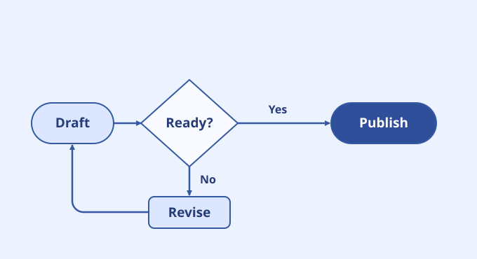
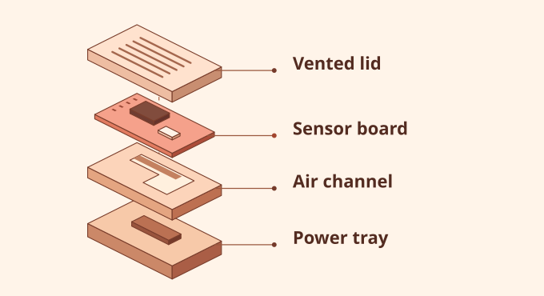
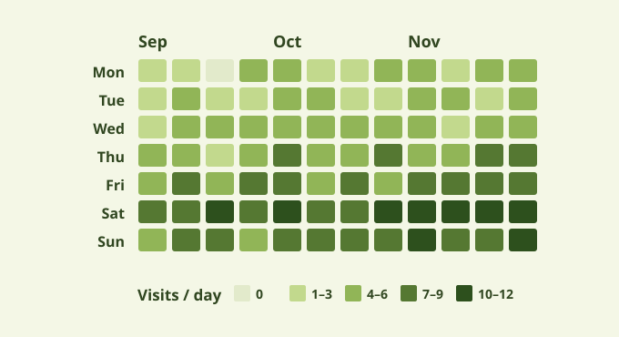
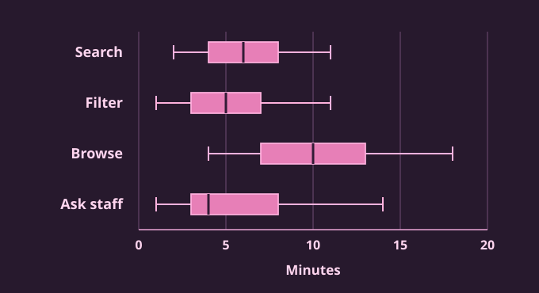
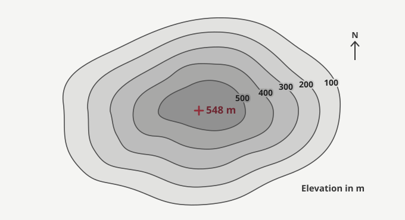
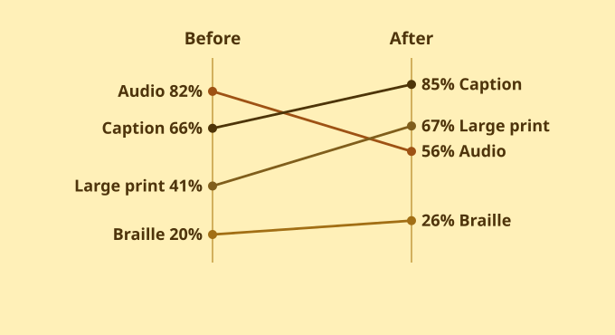
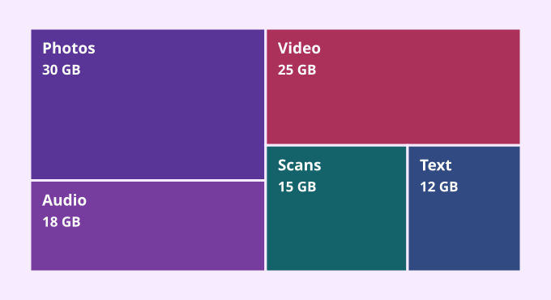

# Praxis Design System Skill

**Choose a design direction from the brief, then check it in the browser.**

[繁體中文](README.zh-TW.md) · [Quick start](#quick-start) · [Worked example](#worked-example) · [Diagram showcase](#diagram-showcase) · [Icons](docs/icons.md) · [Design library](#design-library)

[](#quick-start) [](#worked-example) [](#design-library) [](#diagram-showcase) [](LICENSE)

Praxis gives Codex a workflow for designing new interfaces, refining existing ones, and creating project-matched HTML/SVG diagrams.

## Quick start

Run this from the project where you use Codex:

```bash
npx skills add JasonLn0711/praxis-design-system-skill --skill praxis-design-system -a codex
```

Then invoke `$praxis-design-system` in Codex. Add `-g` to install across projects, or copy the [skill folder](skills/praxis-design-system/) into your project's `.agents/skills/`.

| If you want to… | Try asking |
| --- | --- |
| Design a new site | “Use `$praxis-design-system` to compare two directions for a bilingual research archive. Show how readers find the evidence on mobile.” |
| Improve an existing interface | “Use `$praxis-design-system` to improve table density and keyboard navigation. Reuse our design tokens.” |
| Explain a process | “Use `$praxis-design-system` to draw an HTML/SVG swimlane diagram for this approval flow. Show who handles each handoff.” |

## Worked example

> Design a light-mode museum gallery that runs smoothly on modest devices. Visitors should be able to browse the collection and open a work on their phones.

1. **Shortlist.** The gallery profile includes Minimalism & Swiss Style. Requiring light mode and low rendering cost screens out 3D & Hyperrealism.
2. **Design.** Put the artwork first. Keep the title and artist with each work, and reuse the site's typography and color tokens.
3. **Verify.** Open a work on mobile, then return to the same place in the collection. Check that keyboard users can follow the same path.

To reproduce the shortlist from a cloned repository, run:

```bash
python3 skills/praxis-design-system/scripts/shortlist.py museum-gallery --mode light --low-cost
```

## Diagram showcase

Select any chart to open its full-size SVG.

<p>
  <a href="docs/examples/flowchart-publishing.svg"></a>
  <a href="docs/examples/exploded-sensor.svg"></a>
</p>

<p>
  <a href="docs/examples/calendar-reading-room.svg"></a>
  <a href="docs/examples/box-plot-lookup.svg"></a>
</p>

<p>
  <a href="docs/examples/polar-library.svg"></a>
  <a href="docs/examples/contours-hill.svg"></a>
</p>

<p>
  <a href="docs/examples/slope-accessibility.svg"></a>
  <a href="docs/examples/treemap-archive.svg"></a>
</p>

## Design library

| I'm looking for… | Where to start |
| --- | --- |
| Product patterns, palettes and typography | UI/UX Pro Max and Design Pro |
| Composition, motion and 3D | Taste Skill, Taste Skill Classics and RCS Frontend Skill |
| Interface analysis, polish and acceptance | Impeccable and Frontend Codex Skills |
| Diagram types, layout rules and examples | Diagram Design |
| SVG icons for interfaces and diagrams | [Praxis icon gallery](docs/icons.md) |
| Browser behavior, compatibility and fallbacks | Google Modern Web Guidance |
| A method for researching design references | Refero |

### Look up a diagram

Look up an exact record by ID. For example, `diagrams/swimlane` returns the swimlane specification and the light, dark and editorial examples.

```bash
python3 skills/praxis-design-system/scripts/catalog.py --show diagrams/swimlane
```

[Browse all sources and query commands](skills/praxis-design-system/references/sources.md) · [繁體中文實作指南](skills/praxis-design-system/references/practice.zh-TW.md)

## License

Praxis-authored material uses the [MIT License](LICENSE). Bundled sources retain their respective licenses and credits. [Third-party notices](THIRD_PARTY_NOTICES.md)
