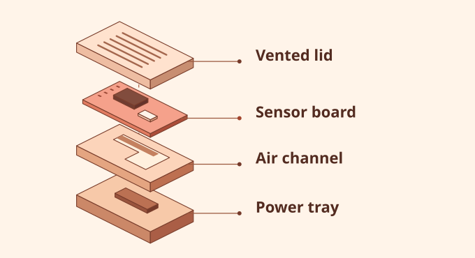
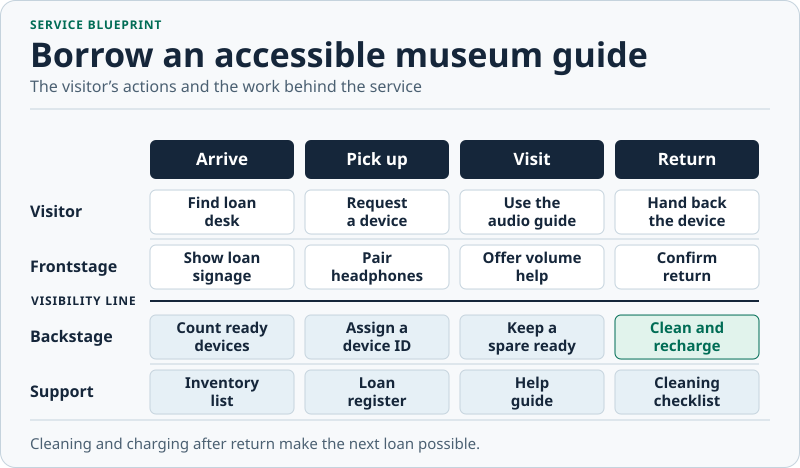
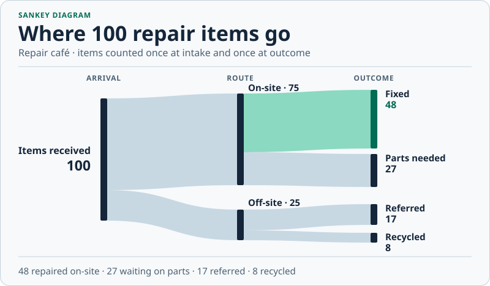
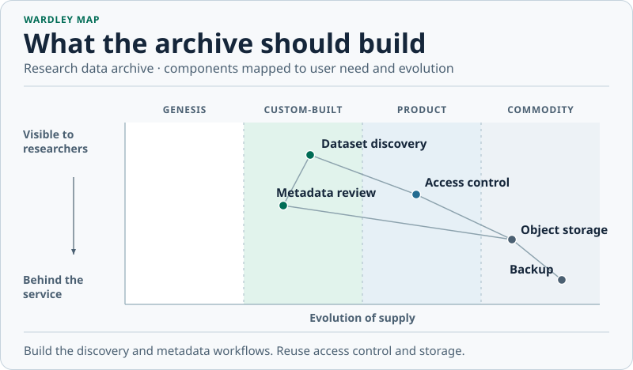
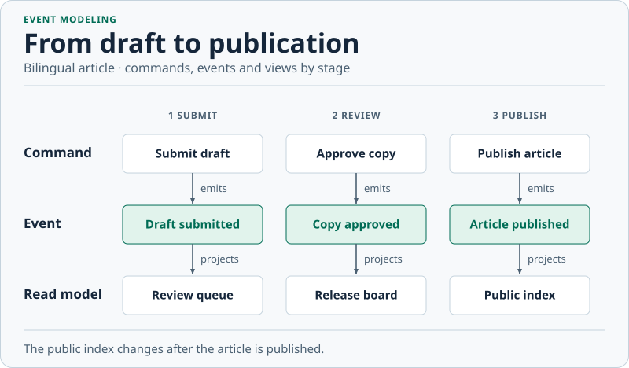
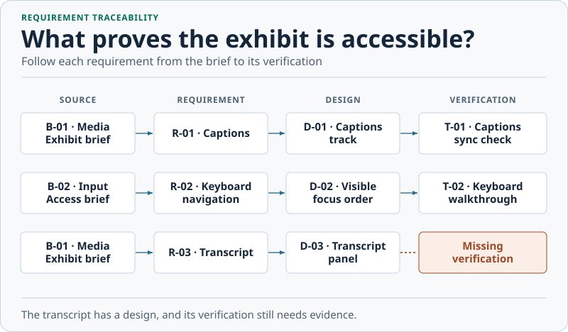
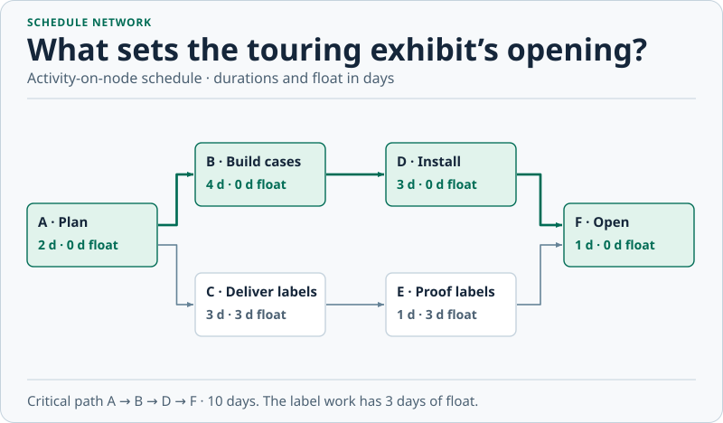
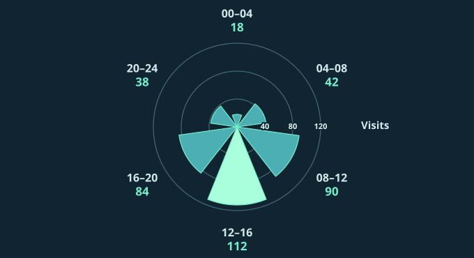

# Praxis Design System Skill

**從需求選出設計方向，再用瀏覽器驗收。**

[English](README.md) · [快速上手](#快速上手) · [實際範例](#實際範例) · [圖解範例](#圖解範例) · [設計資料庫](#設計資料庫)

[](#快速上手) [](#實際範例) [](#設計資料庫) [](#圖解範例) [](LICENSE)

Praxis 提供一套 Codex 設計流程，可用於新介面、既有網站精修，以及符合專案風格的 HTML/SVG 圖解。

## 快速上手

在要使用 Codex 的專案裡執行：

```bash
npx skills add JasonLn0711/praxis-design-system-skill --skill praxis-design-system -a codex
```

接著在 Codex 輸入 `$praxis-design-system`。想跨專案使用，可在安裝指令加上 `-g`，也可以把[整個技能資料夾](skills/praxis-design-system/)複製到專案的 `.agents/skills/`。

| 想做什麼 | 可以這樣問 |
| --- | --- |
| 設計新網站 | 「用 `$praxis-design-system` 比較兩種雙語研究網站的設計方向，說明讀者怎麼在手機上找到證據。」 |
| 改善既有介面 | 「用 `$praxis-design-system` 改善表格密度與鍵盤操作，沿用現有設計 token。」 |
| 解釋一個流程 | 「用 `$praxis-design-system` 畫一張 HTML/SVG 泳道圖，標出每次交接由誰接手。」 |

## 實際範例

> 設計一個淺色的博物館館藏頁，讓效能較低的裝置也能順暢瀏覽。訪客要能在手機上瀏覽館藏並開啟單件作品。

1. **選型。** 館藏情境的候選包含極簡瑞士風格。以淺色模式與低渲染成本篩選時，3D 寫實風格會被排除。
2. **設計。** 讓作品成為視覺主角，把作品名與作者放在同一組，沿用網站的字階與語意色。
3. **驗收。** 在手機開啟單件作品，再返回原本的館藏位置。用鍵盤確認能走完相同流程。

若要重現候選清單，可在 repo 根目錄執行：

```bash
python3 skills/praxis-design-system/scripts/shortlist.py museum-gallery --mode light --low-cost
```

## 圖解範例

八個示意情境。點開任一圖片即可查看原尺寸 SVG。

<p>
  <a href="docs/examples/exploded-sensor.svg"></a>
  <a href="docs/examples/service-blueprint-museum.svg"></a>
</p>

<p>
  <a href="docs/examples/sankey-repair-cafe.svg"></a>
  <a href="docs/examples/wardley-archive.svg"></a>
</p>

<p>
  <a href="docs/examples/event-modeling-publishing.svg"></a>
  <a href="docs/examples/traceability-accessibility.svg"></a>
</p>

<p>
  <a href="docs/examples/schedule-touring-exhibit.svg"></a>
  <a href="docs/examples/polar-library.svg"></a>
</p>

## 設計資料庫

| 想查的內容 | 來源 |
| --- | --- |
| 產品情境、配色與字體 | UI/UX Pro Max、Design Pro |
| 構圖、動態與 3D | Taste Skill、Taste Skill Classics、RCS Frontend Skill |
| 介面分析、精修與驗收 | Impeccable、Frontend Codex Skills |
| 圖解類型、排版規格與範例 | Diagram Design |
| 瀏覽器行為、相容性與備援 | Google Modern Web Guidance |
| 設計參考的研究方法 | Refero |

### 查詢圖解

可用 ID 查閱完整紀錄。以 `diagrams/swimlane` 為例，會顯示泳道圖規格，以及淺色、深色和編輯式範例的路徑。

```bash
python3 skills/praxis-design-system/scripts/catalog.py --show diagrams/swimlane
```

[完整來源與查詢指令](skills/praxis-design-system/references/sources.md) · [繁體中文選型與實作指南](skills/praxis-design-system/references/practice.zh-TW.md)

## 授權

Praxis 原創內容採用 [MIT 授權](LICENSE)。各上游資料沿用原始授權與署名。 [第三方授權及署名](THIRD_PARTY_NOTICES.md)
