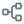

# Praxis Icons / 圖示

Select an icon to open its SVG. 點選圖示即可開啟 SVG 原檔。

| Navigation / 導覽 | Actions / 操作 |
| --- | --- |
| <a href="../skills/praxis-design-system/assets/icons/search.svg"> Search 搜尋</a> | <a href="../skills/praxis-design-system/assets/icons/external-link.svg"> External link 外部連結</a> |
| <a href="../skills/praxis-design-system/assets/icons/filter.svg"> Filter 篩選</a> | <a href="../skills/praxis-design-system/assets/icons/download.svg"> Download 下載</a> |
| <a href="../skills/praxis-design-system/assets/icons/menu.svg"> Menu 選單</a> | <a href="../skills/praxis-design-system/assets/icons/copy.svg"> Copy 複製</a> |
| <a href="../skills/praxis-design-system/assets/icons/arrow-right.svg"> Next 下一步</a> | <a href="../skills/praxis-design-system/assets/icons/close.svg"> Close 關閉</a> |

| Feedback / 回饋 | Design / 設計 |
| --- | --- |
| <a href="../skills/praxis-design-system/assets/icons/check-circle.svg"> Success 完成</a> | <a href="../skills/praxis-design-system/assets/icons/layers.svg"> Layers 圖層</a> |
| <a href="../skills/praxis-design-system/assets/icons/warning.svg"> Warning 注意</a> | <a href="../skills/praxis-design-system/assets/icons/diagram.svg"> Diagram 圖解</a> |
| <a href="../skills/praxis-design-system/assets/icons/info.svg"> Information 資訊</a> | <a href="../skills/praxis-design-system/assets/icons/code.svg"> Code 程式碼</a> |
| <a href="../skills/praxis-design-system/assets/icons/keyboard.svg"> Keyboard 鍵盤</a> | <a href="../skills/praxis-design-system/assets/icons/evidence.svg"> Evidence 驗證紀錄</a> |

- [Praxis mark / 品牌圖示](../skills/praxis-design-system/assets/praxis.svg)
- [Cloud and IT icons / 雲端與 IT 圖示](../skills/praxis-design-system/references/.upstream/diagram-design/skills/diagram-design/references/primitive-icons.md)
- [MIT](../LICENSE) · [Third-party credits / 第三方署名](../THIRD_PARTY_NOTICES.md)
